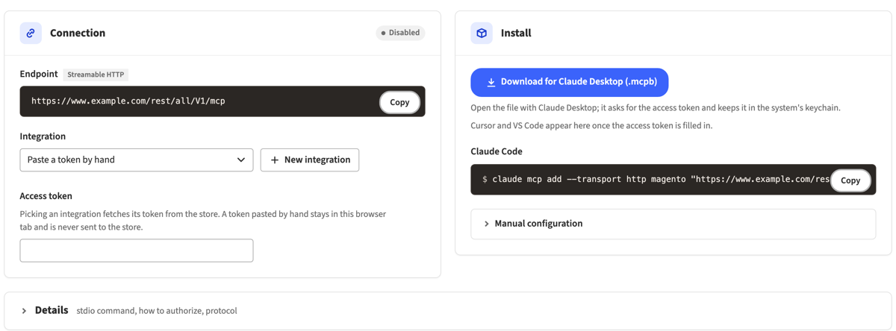
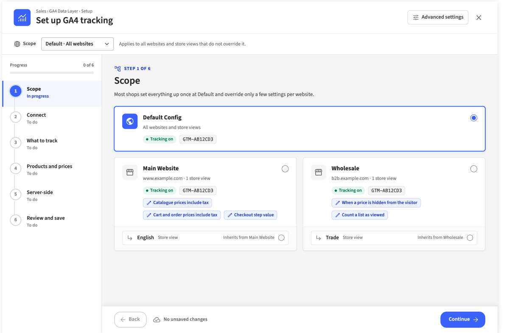
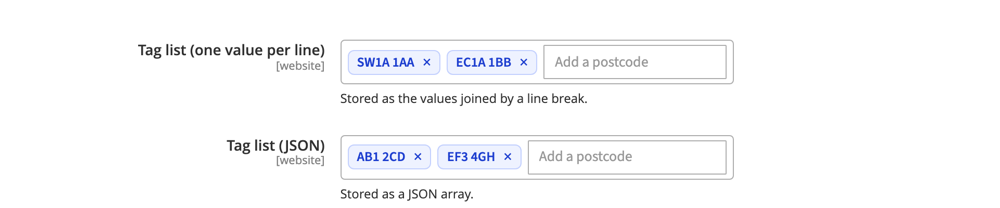

# Admin UI kit for Magento 2

One look for Magento admin screens. The module ships a single stylesheet of small components (buttons, cards,
notices, fields, controls, badges, a status panel, code blocks, lists, facts and disclosures) and the typeface they
are drawn in. A module that wants the look composes these classes in its own markup. A page that does not ask for
the kit never loads it.

The module has no PHP logic: a layout handle, a stylesheet and three font files.

## Screenshots

The kit on three admin screens of other modules: the MCP Server page, the GA4 setup wizard and a configuration
field.







## Requirements

- PHP 8.1 or higher
- Magento 2.4.x (Open Source or Adobe Commerce)

## Installation

### Via Composer (recommended)
```bash
composer require hryvinskyi/magento2-admin-ui
bin/magento module:enable Hryvinskyi_AdminUi
bin/magento setup:upgrade
bin/magento cache:flush
```

### Manual Installation
1. Download the module from GitHub.
2. Place it in `app/code/Hryvinskyi/AdminUi`.
3. Run:
```bash
bin/magento module:enable Hryvinskyi_AdminUi
bin/magento setup:upgrade
bin/magento cache:flush
```

A module that uses the kit requires it: `hryvinskyi/magento2-admin-ui` in its `composer.json` and
`Hryvinskyi_AdminUi` in the `<sequence>` of its `etc/module.xml`.

## Using the kit on a page

1. In the page's layout file, add the kit's handle in the same file as the page's own stylesheet:

   ```xml
   <page xmlns:xsi="http://www.w3.org/2001/XMLSchema-instance"
         xsi:noNamespaceSchemaLocation="urn:magento:framework:View/Layout/etc/page_configuration.xsd">
       <update handle="hryvinskyi_admin_ui"/>
       <head>
           <css src="Vendor_Module::css/page.css"/>
       </head>
       …
   </page>
   ```

   Magento merges a file's `<update>` handles before the file's own content, so the kit's `<link>` comes before the
   page's. A page rule then overrides a kit rule of the same weight by order alone. Keep the `<update>` in the same
   file as the `<css>`: declared elsewhere, the order is not guaranteed.

2. Put `class="hui"` on the element that encloses everything you want styled:

   ```html
   <div class="hui">
       …kit components…
   </div>
   ```

### Two roots

| Class | Carries | Use it for |
|-------|---------|------------|
| `hui` | the tokens and the base rules: the typeface, `box-sizing`, the resets of the admin theme's button shadows, the focus ring, headings, `[hidden]` | the module's own markup |
| `hui-tokens` | the tokens only | markup the module does not own, such as a Magento UI listing: its buttons and controls keep the admin theme's behaviour, while a skin of your own reads `var(--hui-*)` |

The roots nest. `hui-tokens` can wrap a block whose own root carries `hui`.

### Specificity

A base component class is a single class (`.hui-button`, `.hui-card`), and only the tokens and the base rules hang on
the root. Tones and states can weigh more — up to four classes, attributes and pseudo-classes
(`[data-tone='warning'].hui-notice`, `.hui-switch[aria-checked='true'] .hui-switch__track`, the primary anchor
button's link states). A page's own rule of one class, loaded after the kit, wins over a base class by order, and a
rule of two classes (`.my-footer .hui-button--secondary`) wins over a base class anywhere; to restyle a tone or a
state, a consumer overrides the part's tokens rather than out-weighing the kit's selector.

### `hidden`

Kit components set `display` on a class, and a class beats the browser's own `[hidden]` rule. The kit ends with
`.hui [hidden] { display: none; }`, so inside a `hui` root an element with the `hidden` attribute stays hidden,
whatever kit class it carries. Pages that show and hide server-rendered parts with `hidden` rely on this rule. Inside
a `hui-tokens` root without `hui`, the rule does not apply.

## Components

Icons are the module's own inline SVG; the kit sizes them with `hui-icon hui-icon--14` … `hui-icon--30` (in steps of
two) and colours them with `currentColor`. `hui-sr-only` hides a text visually and keeps it for screen readers.

### Buttons and links

```html
<button type="button" class="hui-button hui-button--primary">Save</button>
<button type="button" class="hui-button hui-button--secondary">Test connection</button>
<button type="button" class="hui-button hui-button--tertiary">Copy</button>
<button type="button" class="hui-button hui-button--quiet">Reset</button>
<button type="button" class="hui-button hui-button--link">Show details</button>
<a class="hui-button hui-button--anchor hui-button--primary" href="…">Open</a>
```

A button in a row of fields adds `hui-button--control`: it takes the fields' height, border width and radius, so it
lines up with the input or select beside it, and keeps its variant's colours, border colour included.

```html
<div class="hui-input-row">
    <div class="hui-select hui-select--long">…</div>
    <a class="hui-button hui-button--anchor hui-button--secondary hui-button--control" href="…">New integration</a>
</div>
```

A link drawn as a button adds `hui-button--anchor`, so it keeps the variant's text colour against the admin theme's
link colours. A busy button sets `aria-busy="true"` and stays in the focus order; `disabled` dims it.

### Card and panel

```html
<section class="hui-card">
    <header class="hui-card__head">
        <span class="hui-card__tile"><svg class="hui-icon hui-icon--18" aria-hidden="true">…</svg></span>
        <h2 class="hui-card__title">Connection</h2>
        <div class="hui-card__aside"><span class="hui-badge hui-badge--on"><span class="hui-badge__dot"></span>On</span></div>
    </header>
    <div class="hui-card__body">…</div>
</section>
```

A card head draws its own divider. For a line under the title, wrap the title and a `hui-card__subtitle` in
`hui-card__heading`:

```html
<header class="hui-card__head">
    <span class="hui-card__tile"><svg class="hui-icon hui-icon--18" aria-hidden="true">…</svg></span>
    <div class="hui-card__heading">
        <h2 class="hui-card__title">Sections</h2>
        <p class="hui-card__subtitle">Areas of the store; while one is off, nothing in it runs.</p>
    </div>
</header>
```

`hui-card__subtitle` is muted and sets its own margin, so a `<p>` keeps no paragraph margin from the admin theme. Out
of a heading it sits on the title's line, as in a disclosure's summary or a heading above a listing.

`hui-panel` (`__head`, `__icon`, `__title`, `__body`) is the smaller sibling for an aside.

### Layout

```html
<div class="hui-stack">        <!-- cards one under another -->
    <div class="hui-grid">     <!-- two equal columns -->
        <section class="hui-card">…</section>
        <section class="hui-card">…</section>
        <section class="hui-card hui-grid__full">…spans both columns…</section>
    </div>
</div>

<div class="hui-columns">      <!-- a main column beside a 340px aside -->
    <div class="hui-columns__main">…</div>
    <aside class="hui-columns__aside">…</aside>
</div>
```

`hui-grid` and `hui-columns` fall to one column below 900px of viewport; `hui-columns--single` is one column always.

### Actions

```html
<div class="hui-actions">
    <a class="hui-button hui-button--anchor hui-button--primary" href="…">Download</a>
    <button type="button" class="hui-button hui-button--secondary">Add to the editor</button>
    <button type="button" class="hui-button hui-button--link">More options</button>
</div>
```

Buttons, links or small controls in one row, with the kit's gap between them; the row wraps when the width runs out.

### Notice and strip

```html
<div class="hui-notice" data-tone="warning" role="status">
    <svg class="hui-icon hui-icon--16 hui-notice__icon" aria-hidden="true">…</svg>
    <div class="hui-notice__text">The connection has not been tested yet.</div>
    <a class="hui-notice__action hui-button hui-button--anchor hui-button--tertiary" href="…">Settings</a>
</div>
```

`data-tone` is `success`, `warning` or `error`; without it the notice is neutral. `hui-notice--muted` is an
informational notice on a grey ground. `hui-strip` (`__icon`, `__text`) is the wider, one-line form for the top of a
page.

### Field

```html
<div class="hui-field">
    <div class="hui-field__head">
        <label class="hui-field__label" for="api-key">API key</label>
        <span class="hui-field__tag">Required</span>
    </div>
    <div class="hui-field__help">Found in your account settings.</div>
    <input id="api-key" class="hui-input hui-input--long hui-input--mono" type="text">
    <div class="hui-field__error">Enter a key.</div>
    <div class="hui-origin-line"><span class="hui-origin">Default</span></div>
</div>
```

`hui-origin` shows where a value comes from; `hui-origin--own` marks a value set at this level.

### Input and select

```html
<div class="hui-input-row">
    <input class="hui-input hui-input--short" type="number" aria-invalid="false">
    <span class="hui-input-row__suffix">seconds</span>
    <span class="hui-input-row__note">Between 1 and 60</span>
</div>

<div class="hui-select hui-select--medium">
    <select class="hui-select__control">…</select>
    <svg class="hui-icon hui-icon--20 hui-select__chevron" viewBox="0 0 20 20" aria-hidden="true">
        <path d="M5.5 7.5 10 12l4.5-4.5"/>
    </svg>
</div>
```

Widths: `--short` (90px), `--medium` (240px), `--long` (340px), `--full`, `--auto`. `hui-input--mono` sets the
monospace stack; `hui-input--masked` draws a value that is shown but not editable. `aria-invalid="true"` draws the
error border. `hui-select--strong` sets the value in bold; `hui-select--compact` is a small native select for a table
cell.

### Switch

```html
<button type="button" class="hui-switch" role="switch" aria-checked="true">
    <span class="hui-switch__track"><span class="hui-switch__knob"></span></span>
    <span class="hui-switch__text">Enabled</span>
</button>
```

`aria-checked` draws the state; `hui-switch--small` is the compact size.

### Radios

```html
<div class="hui-radios hui-radios--cards hui-radios--column" role="radiogroup">
    <label class="hui-radio" data-checked="true">
        <span class="hui-radio__tile"><svg class="hui-icon hui-icon--20" aria-hidden="true">…</svg></span>
        <span class="hui-radio__text">
            <span class="hui-radio__label">Automatic</span>
            <span class="hui-radio__description">The store decides.</span>
        </span>
        <input class="hui-radio__input" type="radio" name="mode" checked>
    </label>
</div>
```

Without `hui-radios--cards` the radios are plain. `aria-disabled="true"` on the group dims it once;
`data-disabled="true"` on one option dims only that one.

### Badge

```html
<span class="hui-badge">12 items</span>
<span class="hui-badge hui-badge--on"><span class="hui-badge__dot"></span>On</span>
<span class="hui-badge hui-badge--off"><span class="hui-badge__dot"></span>Off</span>
<span class="hui-badge hui-badge--warn"><span class="hui-badge__dot"></span>On · read-only</span>
<span class="hui-badge hui-badge--override">Overridden</span>
<span class="hui-badge hui-badge--fixed">Fixed</span>
<span class="hui-badge hui-badge--recommended">Recommended</span>
<span class="hui-badge hui-badge--code">Vendor_Module::resource</span>
```

`hui-badge--on`, `hui-badge--off` and `hui-badge--warn` with `hui-badge__dot` draw a state as a dot and a word:
on in green, off in grey, and in the warning tone a state that is on with a reservation. `hui-badge--source` makes
room for a leading icon.

### Status panel

```html
<div class="hui-status" data-state="ok">
    <div class="hui-status__summary">
        <span class="hui-status__tile"><svg class="hui-icon hui-icon--20" aria-hidden="true">…</svg></span>
        <span class="hui-status__words">
            <span class="hui-status__word">Connected</span>
            <span class="hui-status__note">Checked a minute ago</span>
        </span>
    </div>
    <div class="hui-status__line">
        <span class="hui-status__label">Last answer</span>
        <div class="hui-status__box">
            <span class="hui-status__dot"></span>
            <span class="hui-status__text">200 OK</span>
        </div>
    </div>
    <button type="button" class="hui-button hui-button--secondary">Check again</button>
</div>
```

`data-state` is `ok` or `invalid`; without it the panel is neutral. `data-tone="muted"` or `"error"` on
`hui-status__text` changes the text's colour alone.

### Code

```html
<div class="hui-code">
    <pre class="hui-code__block" tabindex="0"><code><span class="hui-code__prompt">$ </span>bin/magento cache:flush</code></pre>
    <div class="hui-code__actions">
        <button type="button" class="hui-button hui-button--tertiary">Copy</button>
    </div>
</div>
```

A dark block for a command or a configuration. The text never wraps: a long line scrolls inside the block and never
widens the page. Give the block `tabindex="0"` so a keyboard can scroll it. `hui-code__actions` is optional and holds
buttons in the block's top right corner, beside the text. `hui-code__prompt` draws a prompt that a selection leaves
out.

### List

```html
<section class="hui-card">
    <header class="hui-card__head"><h2 class="hui-card__title">Feeds</h2></header>
    <ul class="hui-list">
        <li class="hui-list__row">
            <div class="hui-list__main">
                <span class="hui-list__title">Product feed</span>
                <span class="hui-list__meta">Daily at 02:00 · 3 store views</span>
            </div>
            <div class="hui-list__aside">
                <span class="hui-list__badges"><span class="hui-badge">42</span></span>
                <button type="button" class="hui-button hui-button--tertiary">Switch off</button>
            </div>
        </li>
        <li class="hui-list__row hui-list__row--muted">…</li>
    </ul>
</section>
```

A plain list of rows: a title with muted meta on the left, badges and an action on the right. Put it directly in a
card (not in its body) and the rows run edge to edge. `hui-list__row--muted` marks a row that is switched off.

### Facts

```html
<dl class="hui-facts">
    <div class="hui-facts__item">
        <dt class="hui-facts__label">Protocol</dt>
        <dd class="hui-facts__value">2025-06-18</dd>
    </div>
    <div class="hui-facts__item">
        <dt class="hui-facts__label">Abilities</dt>
        <dd class="hui-facts__value">42</dd>
    </div>
</dl>
```

Label and value pairs, each in a box of its own: the label muted, the value strong. The boxes fill the row, each at
least 150px wide, and wrap as the width runs out. The label and the value carry their classes, so the admin theme's
`<dt>` and `<dd>` margins never reach them.

### Disclosure

```html
<details class="hui-disclosure hui-disclosure--boxed">
    <summary class="hui-disclosure__summary">Manual configuration</summary>
    <div class="hui-disclosure__body">…</div>
</details>
```

A native `<details>`: the browser keeps the open state, the keyboard and the announcement; the kit draws a chevron
that turns when the part is open, and the focus ring. Without `hui-disclosure--boxed` the summary is a link-coloured
line. `hui-disclosure` on a link button (`hui-button hui-button--link hui-disclosure`) draws a toggle that the
module's script drives.

## Theming

Every colour, radius, shadow and font stack is a custom property (`--hui-*`) declared on the outermost kit root of the
page. The declaration has no weight of its own, so any rule that sets a property overrides it:

```css
.hui,
.hui-tokens {
    --hui-accent: #0b7a5a;
    --hui-accent-hover: #075c43;
    --hui-accent-hover-line: #075c43;
    --hui-switch-on: #0b7a5a;
}
```

A root nested inside another inherits the outer root's properties instead of declaring them again, so an override
set on the outer root reaches everything inside it.

Main groups: text (`--hui-ink`, `--hui-ink-soft`, `--hui-muted`, `--hui-faint`), surfaces (`--hui-surface`,
`--hui-canvas`, `--hui-subtle`, `--hui-well`, `--hui-neutral`), lines (`--hui-line`, `--hui-line-faint`,
`--hui-line-mid`, `--hui-line-strong`), the accent (`--hui-accent*`), tones (`--hui-ok*`, `--hui-warn*`,
`--hui-error*`), focus and links (`--hui-focus`, `--hui-focus-glow`, `--hui-link`), buttons and the switch
(`--hui-button-*`, `--hui-switch-*`), code (`--hui-code-bg`, `--hui-code-ink`, `--hui-code-muted`, `--hui-code-line`),
shapes (`--hui-radius-*`, `--hui-shadow-*`) and the font stacks (`--hui-font`, `--hui-mono`). The stylesheet's token
block lists them all.

## Browser support

Chrome and Edge 88, Firefox 84, Safari 14.1 or newer. The kit uses custom
properties, grid, flex `gap`, `:is()`, `:where()` and `:not()` with a selector list. `text-wrap: pretty` is applied
where the browser knows it and ignored elsewhere.

## Typeface

The kit is drawn in Source Sans 3, served from the module's own static
files (`view/adminhtml/web/fonts/source-sans-3/`): the latin subset in weights 400, 600 and 700, so the admin never
asks a font service. Any glyph outside the subset falls back to the next family in the stack (Open Sans, Helvetica,
Arial). The files come from `@fontsource/source-sans-3` 5.3.0. The typeface is licensed under the SIL Open Font
License 1.1; the licence text is `OFL.txt` beside the files.

## Author

**Volodymyr Hryvinskyi**
- Email: volodymyr@hryvinskyi.com
- GitHub: https://github.com/hryvinskyi

## License

This module is licensed under the [MIT License](LICENSE). The typeface keeps its own licence, the SIL Open Font
License 1.1.

## Support

For issues, feature requests, or questions, please contact the author or submit an issue on GitHub.
