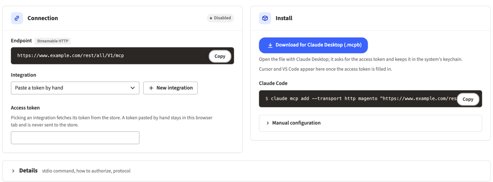
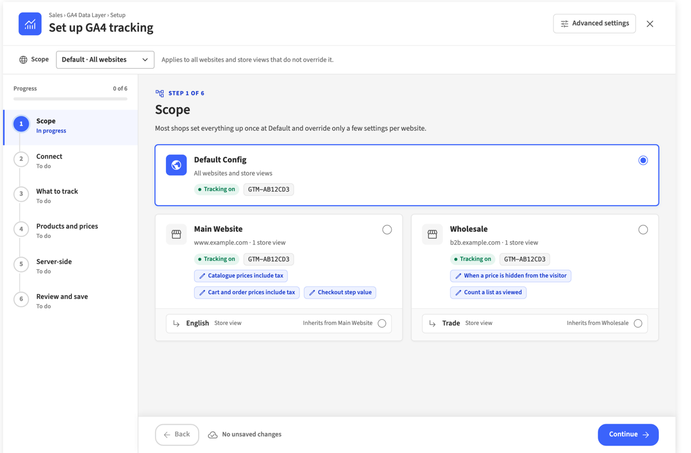
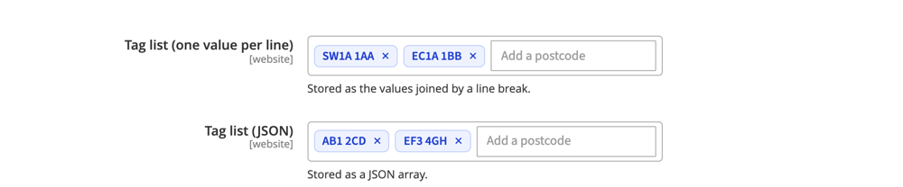

# Admin UI kit for Magento 2

One look for Magento admin screens. The module ships a single stylesheet of small components (buttons, cards,
notices, fields, controls, badges, a status panel, code blocks, lists, facts and disclosures, and the parts of list
and report pages: tabs, filter chips, data tables, a pager, a drawer, charts, a store-view bar, a code editor) and the
typeface they are drawn in. A
module that wants the look composes these classes in its own markup. A page that does not ask for the kit never loads
it.

The module has three parts:

- **The stylesheet** (`hui-*` classes) and its typeface, linked by a layout handle. Server-rendered markup draws every
  part with the classes alone.
- **The browser kit**: the same parts as Preact components, with the kit's own wording, a JSON client and the readers
  every parser of the server's answers is built from, published to the page as one ES module
  (`@hryvinskyi/admin-ui`).
- **The island page host**: a layout handle and a view model that print one Preact island on an admin page — its
  document, the import map that resolves the kit and the UI library, and its entry module — and the module page: a
  module's header, tabs, store views, links, permissions and wording built into that document on the server and read
  and drawn by the browser kit.

## Screenshots

The kit on three admin screens of other modules: a connection page, a setup wizard and a configuration field.







## Requirements

- PHP 8.1 or higher
- Magento 2.4.x (Open Source or Adobe Commerce)

## Installation

### Via Composer (recommended)
```bash
composer require hryvinskyi/magento2-admin-ui
bin/magento module:enable Hryvinskyi_AdminUi
bin/magento setup:upgrade
bin/magento cache:flush
```

### Manual Installation
1. Download the module from GitHub.
2. Place it in `app/code/Hryvinskyi/AdminUi`.
3. Run:
```bash
bin/magento module:enable Hryvinskyi_AdminUi
bin/magento setup:upgrade
bin/magento cache:flush
```

A module that uses the kit requires it: `hryvinskyi/magento2-admin-ui` in its `composer.json` and
`Hryvinskyi_AdminUi` in the `<sequence>` of its `etc/module.xml`.

## Using the kit on a page

1. In the page's layout file, add the kit's handle in the same file as the page's own stylesheet:

   ```xml
   <page xmlns:xsi="http://www.w3.org/2001/XMLSchema-instance"
         xsi:noNamespaceSchemaLocation="urn:magento:framework:View/Layout/etc/page_configuration.xsd">
       <update handle="hryvinskyi_admin_ui"/>
       <head>
           <css src="Vendor_Module::css/page.css"/>
       </head>
       …
   </page>
   ```

   Magento merges a file's `<update>` handles before the file's own content, so the kit's `<link>` comes before the
   page's. A page rule then overrides a kit rule of the same weight by order alone. Keep the `<update>` in the same
   file as the `<css>`: declared elsewhere, the order is not guaranteed.

2. Put `class="hui"` on the element that encloses everything you want styled:

   ```html
   <div class="hui">
       …kit components…
   </div>
   ```

### Two roots

| Class | Carries | Use it for |
|-------|---------|------------|
| `hui` | the tokens and the base rules: the typeface, `box-sizing`, the resets of the admin theme's button shadows, the focus ring, headings, `[hidden]` | the module's own markup |
| `hui-tokens` | the tokens only | markup the module does not own, such as a Magento UI listing: its buttons and controls keep the admin theme's behaviour, while a skin of your own reads `var(--hui-*)` |

The roots nest. `hui-tokens` can wrap a block whose own root carries `hui`.

### Specificity

A base component class is a single class (`.hui-button`, `.hui-card`), and only the tokens and the base rules hang on
the root. Tones and states can weigh more — up to four classes, attributes and pseudo-classes
(`[data-tone='warning'].hui-notice`, `.hui-switch[aria-checked='true'] .hui-switch__track`, the primary anchor
button's link states). A page's own rule of one class, loaded after the kit, wins over a base class by order, and a
rule of two classes (`.my-footer .hui-button--secondary`) wins over a base class anywhere; to restyle a tone or a
state, a consumer overrides the part's tokens rather than out-weighing the kit's selector.

### `hidden`

Kit components set `display` on a class, and a class beats the browser's own `[hidden]` rule. The kit ends with
`.hui [hidden] { display: none; }`, so inside a `hui` root an element with the `hidden` attribute stays hidden,
whatever kit class it carries. Pages that show and hide server-rendered parts with `hidden` rely on this rule. Inside
a `hui-tokens` root without `hui`, the rule does not apply.

## Components

Icons are the module's own inline SVG; the kit sizes them with `hui-icon hui-icon--14` … `hui-icon--30` (in steps of
two) and colours them with `currentColor`. `hui-icon--spin` turns a glyph once a second and holds it still for a
person who asks for reduced motion; the script's `Icon` puts it on the progress glyph (`progress_activity`) wherever
that glyph is drawn, because it only ever means "working", and on no other. `hui-sr-only` hides a text visually and keeps it for screen readers.

### Buttons and links

```html
<button type="button" class="hui-button hui-button--primary">Save</button>
<button type="button" class="hui-button hui-button--secondary">Test connection</button>
<button type="button" class="hui-button hui-button--tertiary">Copy</button>
<button type="button" class="hui-button hui-button--quiet">Reset</button>
<button type="button" class="hui-button hui-button--link">Show details</button>
<a class="hui-button hui-button--anchor hui-button--primary" href="…">Open</a>
```

Every button has one shape: a 1px border and the box radius (`--hui-radius-box`). A variant changes only the colours
of the border, the background and the text, so buttons of different weight read as one family in one row. Primary,
secondary and quiet are one height; tertiary is the compact size. The link button has no border and no radius.

A button in a row of fields adds `hui-button--control`: it takes the fields' height and radius, so it lines up with
the input or select beside it, and keeps its variant's colours, border colour included. It is the one button that
does not take the box radius.

```html
<div class="hui-input-row">
    <div class="hui-select hui-select--long">…</div>
    <a class="hui-button hui-button--anchor hui-button--secondary hui-button--control" href="…">New integration</a>
</div>
```

A link drawn as a button adds `hui-button--anchor`, so it keeps the variant's text colour against the admin theme's
link colours. A busy button sets `aria-busy="true"` and stays in the focus order; `disabled` dims it. The script's
`Button` draws the control button as `variant="control"` (`hui-button--secondary hui-button--control`).

### Card and panel

```html
<section class="hui-card">
    <header class="hui-card__head">
        <span class="hui-card__tile"><svg class="hui-icon hui-icon--18" aria-hidden="true">…</svg></span>
        <h2 class="hui-card__title">Connection</h2>
        <div class="hui-card__aside"><span class="hui-badge hui-badge--on"><span class="hui-badge__dot"></span>On</span></div>
    </header>
    <div class="hui-card__body">…</div>
</section>
```

A card head draws its own divider. For a line under the title, wrap the title and a `hui-card__subtitle` in
`hui-card__heading`:

```html
<header class="hui-card__head">
    <span class="hui-card__tile"><svg class="hui-icon hui-icon--18" aria-hidden="true">…</svg></span>
    <div class="hui-card__heading">
        <h2 class="hui-card__title">Sections</h2>
        <p class="hui-card__subtitle">Areas of the store; while one is off, nothing in it runs.</p>
    </div>
</header>
```

`hui-card__subtitle` is muted and sets its own margin, so a `<p>` keeps no paragraph margin from the admin theme. Out
of a heading it sits on the title's line, as in a disclosure's summary or a heading above a listing.

A card whose rows run edge to edge straight under its head takes `hui-card--flush` and leaves out
`hui-card__body`: the head keeps no rule of its own, and the rows draw theirs. The script's `CardFrame` is that card
with a title and a subtitle.

`hui-panel` (`__head`, `__icon`, `__title`, `__body`) is the smaller sibling for an aside.

### Layout

```html
<div class="hui-stack">        <!-- cards one under another -->
    <div class="hui-grid">     <!-- two equal columns -->
        <section class="hui-card">…</section>
        <section class="hui-card">…</section>
        <section class="hui-card hui-grid__full">…spans both columns…</section>
    </div>
</div>

<div class="hui-columns">      <!-- a main column beside a 340px aside -->
    <div class="hui-columns__main">…</div>
    <aside class="hui-columns__aside">…</aside>
</div>
```

`hui-grid` and `hui-columns` fall to one column below 900px of viewport; `hui-columns--single` is one column always.

### Actions

```html
<div class="hui-actions">
    <a class="hui-button hui-button--anchor hui-button--primary" href="…">Download</a>
    <button type="button" class="hui-button hui-button--secondary">Add to the editor</button>
    <button type="button" class="hui-button hui-button--link">More options</button>
</div>
```

Buttons, links or small controls in one row, with the kit's gap between them; the row wraps when the width runs out.

### Notice and strip

```html
<div class="hui-notice" data-tone="warning" role="status">
    <svg class="hui-icon hui-icon--16 hui-notice__icon" aria-hidden="true">…</svg>
    <div class="hui-notice__text">The connection has not been tested yet.</div>
    <a class="hui-notice__action hui-button hui-button--anchor hui-button--tertiary" href="…">Settings</a>
</div>
```

`data-tone` is `success`, `warning` or `error`; without it the notice is neutral. `hui-notice--muted` is an
informational notice on a grey ground. `hui-strip` (`__icon`, `__text`) is the wider, one-line form for the top of a
page.

A notice's glyph sits on the first line of its text however far the text wraps, and the text shares a baseline with
the action; beside a tertiary action the first line sits on the button's centre line. The notice's line height is
`--hui-notice-leading` (1.5), which places the glyph. A browser without `:has()` centres the glyph, the text and the
action on one line.

The script's `Notice` and `MessageStrip` take one `action` (`MessageAction`): a button done on this screen
(`{ label, onClick, busy }`) or a real link to another screen (`{ label, href }`), drawn as `LinkButton`'s tertiary
look with an arrow after its words. An action is one or the other, never both.

### Field

```html
<div class="hui-field">
    <div class="hui-field__head">
        <label class="hui-field__label" for="api-key">API key</label>
        <span class="hui-field__tag">Required</span>
    </div>
    <div class="hui-field__help">Found in your account settings.</div>
    <input id="api-key" class="hui-input hui-input--long hui-input--mono" type="text">
    <div class="hui-field__error">Enter a key.</div>
    <div class="hui-origin-line"><span class="hui-origin">Default</span></div>
</div>
```

`hui-origin` shows where a value comes from; `hui-origin--own` marks a value set at this level.

### Input and select

```html
<div class="hui-input-row">
    <input class="hui-input hui-input--short" type="number" aria-invalid="false">
    <span class="hui-input-row__suffix">seconds</span>
    <span class="hui-input-row__note">Between 1 and 60</span>
</div>

<div class="hui-select hui-select--medium">
    <select class="hui-select__control">…</select>
    <svg class="hui-icon hui-icon--20 hui-select__chevron" viewBox="0 0 20 20" aria-hidden="true">
        <path d="M5.5 7.5 10 12l4.5-4.5"/>
    </svg>
</div>
```

Widths: `--short` (90px), `--medium` (240px), `--long` (340px), `--full`, `--auto`. `hui-input--mono` sets the
monospace stack; `hui-input--masked` draws a value that is shown but not editable. `aria-invalid="true"` draws the
error border. `hui-select--strong` sets the value in bold; `hui-select--compact` is a small native select for a table
cell.

### Switch

```html
<button type="button" class="hui-switch" role="switch" aria-checked="true">
    <span class="hui-switch__track"><span class="hui-switch__knob"></span></span>
    <span class="hui-switch__text">Enabled</span>
</button>
```

`aria-checked` draws the state; `hui-switch--small` is the compact size.

### Row menu

```html
<span class="hui-menu">
    <button type="button" class="hui-menu__button" aria-label="More for Product" aria-haspopup="menu"
            aria-expanded="true" aria-controls="m1">…</button>
    <div id="m1" role="menu" class="hui-menu__list" aria-label="Product">
        <button type="button" role="menuitem" class="hui-menu__item" data-tone="neutral">… Duplicate</button>
        <button type="button" role="menuitem" class="hui-menu__item" data-tone="danger">… Delete</button>
    </div>
</span>
```

The list opens under the button's right edge, 210px wide; `data-tone="danger"` draws an action that destroys
something in the error colour. With the script (`MenuButton`) the page holds whether the menu is open; focus moves to
the first action, the arrow keys, Home and End move between them, and Escape, Tab, a press outside or a choice close
it.

### Radios

```html
<div class="hui-radios hui-radios--cards hui-radios--column" role="radiogroup">
    <label class="hui-radio" data-checked="true">
        <span class="hui-radio__tile"><svg class="hui-icon hui-icon--20" aria-hidden="true">…</svg></span>
        <span class="hui-radio__text">
            <span class="hui-radio__label">Automatic</span>
            <span class="hui-radio__description">The store decides.</span>
        </span>
        <input class="hui-radio__input" type="radio" name="mode" checked>
    </label>
</div>
```

Without `hui-radios--cards` the radios are plain. `aria-disabled="true"` on the group dims it once;
`data-disabled="true"` on one option dims only that one.

### Badge

```html
<span class="hui-badge">12 items</span>
<span class="hui-badge hui-badge--on"><span class="hui-badge__dot"></span>On</span>
<span class="hui-badge hui-badge--off"><span class="hui-badge__dot"></span>Off</span>
<span class="hui-badge hui-badge--warn"><span class="hui-badge__dot"></span>On · read-only</span>
<span class="hui-badge hui-badge--override">Overridden</span>
<span class="hui-badge hui-badge--fixed">Fixed</span>
<span class="hui-badge hui-badge--recommended">Recommended</span>
<span class="hui-badge hui-badge--code">Vendor_Module::resource</span>
```

`hui-badge--on`, `hui-badge--off` and `hui-badge--warn` with `hui-badge__dot` draw a state as a dot and a word:
on in green, off in grey, and in the warning tone a state that is on with a reservation. `hui-badge--source` makes
room for a leading icon. The script's `Badge` with `variant="warn"` draws the dot, or the glyph given as `icon` in its
place (`<Badge variant="warn" icon="warning">2 warnings</Badge>`).

### Status panel

```html
<div class="hui-status" data-state="ok">
    <div class="hui-status__summary">
        <span class="hui-status__tile"><svg class="hui-icon hui-icon--20" aria-hidden="true">…</svg></span>
        <span class="hui-status__words">
            <span class="hui-status__word">Connected</span>
            <span class="hui-status__note">Checked a minute ago</span>
        </span>
    </div>
    <div class="hui-status__line">
        <span class="hui-status__label">Last answer</span>
        <div class="hui-status__box">
            <span class="hui-status__dot"></span>
            <span class="hui-status__text">200 OK</span>
        </div>
    </div>
    <button type="button" class="hui-button hui-button--secondary">Check again</button>
</div>
```

`data-state` is `ok` or `invalid`; without it the panel is neutral. `data-tone="muted"` or `"error"` on
`hui-status__text` changes the text's colour alone.

### Code

```html
<div class="hui-code">
    <pre class="hui-code__block" tabindex="0"><code><span class="hui-code__prompt">$ </span>bin/magento cache:flush</code></pre>
    <div class="hui-code__actions">
        <button type="button" class="hui-button hui-button--tertiary">Copy</button>
    </div>
</div>
```

A dark block for a command or a configuration. The text never wraps: a long line scrolls inside the block and never
widens the page. Give the block `tabindex="0"` so a keyboard can scroll it. `hui-code__actions` is optional and holds
buttons in the block's top right corner, beside the text. `hui-code__prompt` draws a prompt that a selection leaves
out.

### List

```html
<section class="hui-card">
    <header class="hui-card__head"><h2 class="hui-card__title">Feeds</h2></header>
    <ul class="hui-list">
        <li class="hui-list__row">
            <div class="hui-list__main">
                <span class="hui-list__title">Product feed</span>
                <span class="hui-list__meta">Daily at 02:00 · 3 store views</span>
            </div>
            <div class="hui-list__aside">
                <span class="hui-list__badges"><span class="hui-badge">42</span></span>
                <button type="button" class="hui-button hui-button--tertiary">Switch off</button>
            </div>
        </li>
        <li class="hui-list__row hui-list__row--muted">…</li>
    </ul>
</section>
```

A plain list of rows: a title with muted meta on the left, badges and an action on the right. Put it directly in a
card (not in its body) and the rows run edge to edge. `hui-list__row--muted` marks a row that is switched off.

### Facts

```html
<dl class="hui-facts">
    <div class="hui-facts__item">
        <dt class="hui-facts__label">Protocol</dt>
        <dd class="hui-facts__value">2025-06-18</dd>
    </div>
    <div class="hui-facts__item">
        <dt class="hui-facts__label">Abilities</dt>
        <dd class="hui-facts__value">42</dd>
    </div>
</dl>
```

Label and value pairs, each in a box of its own: the label muted, the value strong. The boxes fill the row, each at
least 150px wide, and wrap as the width runs out. The label and the value carry their classes, so the admin theme's
`<dt>` and `<dd>` margins never reach them.

### Disclosure

```html
<details class="hui-disclosure hui-disclosure--boxed">
    <summary class="hui-disclosure__summary">Manual configuration</summary>
    <div class="hui-disclosure__body">…</div>
</details>
```

A native `<details>`: the browser keeps the open state, the keyboard and the announcement; the kit draws a chevron
that turns when the part is open, and the focus ring. Without `hui-disclosure--boxed` the summary is a link-coloured
line. `hui-disclosure` on a link button (`hui-button hui-button--link hui-disclosure`) draws a toggle that the
module's script drives.

### Text area

```html
<div class="hui-area">
    <textarea id="message" class="hui-input hui-input--area hui-input--full" rows="6"
              aria-describedby="message-count"></textarea>
    <div id="message-count" class="hui-area__count" data-state="near">380 of 400 characters</div>
</div>
```

A text of several lines, as high as its `rows`; the person may drag it higher. The count line takes the warning tone
in the limit's last tenth (`data-state="near"`) and the error tone past it (`over`), where the text area also carries
`aria-invalid="true"`. Nothing is cut (no `maxlength`): whether a text past the limit can be saved is the page's
decision. The script's `TextArea` counts by code point, as the server does, and words the line in the kit's phrase.

### Segmented control

```html
<div role="group" class="hui-segmented" aria-label="Period">
    <button type="button" class="hui-segmented__option" aria-pressed="true">7 days</button>
    <button type="button" class="hui-segmented__option" aria-pressed="false" tabindex="-1">30 days</button>
    <button type="button" class="hui-segmented__option" aria-pressed="false" tabindex="-1">90 days</button>
</div>
```

One choice among two to four short options. A locked group carries `aria-disabled="true"` (dimmed) and disables its
buttons. An option may start with a glyph (`<svg class="hui-icon hui-icon--18" aria-hidden="true">`); the label still
names it. With the script (`SegmentedControl`) the group is one Tab stop and the arrow keys choose the neighbour,
wrapping and passing over an option out of reach; an option's `icon` names the kit glyph drawn before its label.

### Filter chips

```html
<div role="group" class="hui-chips" aria-label="Filter">
    <button type="button" class="hui-chip" data-tone="neutral" aria-pressed="true">
        All<span class="hui-chip__count">19</span>
    </button>
    <button type="button" class="hui-chip" data-tone="warning" aria-pressed="false">
        Needs a category<span class="hui-chip__count">3</span>
    </button>
    <button type="button" class="hui-chip hui-chip--control" data-tone="error" aria-pressed="true">
        <svg class="hui-icon hui-icon--16" aria-hidden="true">…</svg>Failed<span class="hui-chip__count">4</span>
    </button>
</div>
```

Idle chips are white; a pressed one takes the accent tint. `data-tone="warning"` tints an idle chip in the warning
colours, `data-tone="error"` a pressed one in the error colours, with the error glyph (the script's `FilterChip` draws
it). `hui-chip--control` is as high as an input, for a chip beside a search field.

### Tabs

```html
<div role="tablist" class="hui-tabs" aria-label="Catalogue">
    <button type="button" role="tab" id="cat-tab-products" class="hui-tabs__tab" aria-selected="true"
            aria-controls="cat-panel-products">Products<span class="hui-tabs__count">19</span></button>
    <button type="button" role="tab" id="cat-tab-categories" class="hui-tabs__tab" aria-selected="false"
            aria-controls="cat-panel-categories" tabindex="-1">Categories<span class="hui-tabs__count">4</span></button>
</div>
<div role="tabpanel" id="cat-panel-products" class="hui-tabpanel" aria-labelledby="cat-tab-products" tabindex="0">…</div>
```

Tabs switch parts of one card. `data-tone="accent"` on a count fills it, for things waiting for the person. The
keyboard needs the script (`Tabs`, `TabPanel`): the arrow keys, Home and End select a tab and focus follows. Moving
between a module's pages is module navigation, not tabs.

### Module navigation

```html
<nav class="hui-modnav" aria-label="Feeds">
    <a class="hui-modnav__link" href="…" aria-current="page">Overview</a>
    <a class="hui-modnav__link" href="…">Waiting<span class="hui-modnav__count">7</span></a>
    <a class="hui-modnav__link" href="…">History</a>
</nav>
```

Real links between a module's admin pages under its page header; the current page is underlined in the accent colour.
The page gives the bar its padding and background.

### Module page

```html
<div class="hui-page">
    <header class="hui-page__header">
        <div class="hui-page__brand">
            <span class="hui-page__tile"><svg class="hui-icon hui-icon--26" aria-hidden="true">…</svg></span>
            <div class="hui-page__heading">
                <p class="hui-page__module">Feeds</p>
                <h1 class="hui-page__title">Overview</h1>
            </div>
        </div>
        <div class="hui-actions hui-page__actions">…</div>
    </header>
    <nav class="hui-modnav" aria-label="Feeds">…</nav>
    <main class="hui-page__main">…</main>
</div>
```

The frame every page of a module draws: the module's glyph tile, its name above the page's, the page's actions at the
right, the module navigation, then the main column (a store-view bar may sit between the navigation and the main
column). The frame is a size container named `hui-page`: it is narrow at 900 px or less of its own width, whatever
the window, and then the main column's padding shrinks and `hui-columns` stack. A page's stylesheet asks
`@container hui-page (max-width: 900px)` for its own narrow rules. The script's `PageShell` and `PageMain` draw it
from a module page's document.

### Data table

```html
<div role="table" class="hui-table" aria-label="Records"
     style="--hui-table-columns: 176px minmax(0,1.5fr) 150px 40px; --hui-table-columns-narrow: 132px minmax(0,1fr) 128px 30px">
    <div role="row" class="hui-table__row hui-table__row--head">
        <div role="columnheader" class="hui-table__cell">Date and time</div>
        <div role="columnheader" class="hui-table__cell">Order</div>
        <div role="columnheader" class="hui-table__cell">Status</div>
        <div class="hui-table__chevron" aria-hidden="true"></div>
    </div>
    <div role="row" class="hui-table__row" data-target="true" data-flag="error">
        <div role="cell" class="hui-table__cell">
            <button type="button" id="records-open-1" class="hui-table__open" aria-label="Record 1">14 Nov, 13:40</button>
        </div>
        <div role="cell" class="hui-table__cell">7f2c…91ab</div>
        <div role="cell" class="hui-table__cell"><span class="hui-pill" data-tone="error">…Not sent</span></div>
        <div class="hui-table__chevron" aria-hidden="true"><svg class="hui-icon hui-icon--20">…</svg></div>
    </div>
</div>
```

ARIA table roles on a grid. The tracks are declared once, on the table, in `--hui-table-columns`, and in
`--hui-table-columns-narrow` for a container under 960 px. A row that opens a drawer (`data-target="true"`) holds a
plain-looking button in its first cell and a chevron at its end, and takes the accent tint on hover, while its drawer
is open (`data-open="true"`) and while it is ticked (`data-selected="true"`). `data-flag="error"` or `"warning"`
draws an edge on a row that needs action; a cell says the same in words. A first column of checkboxes
(`hui-table__cell--check`, `hui-table__check`) ticks rows. A group row (`hui-table__group` holding a
`hui-table__group-toggle` with `aria-expanded`) heads the rows after it. Placeholder rows
(`hui-table__row--skeleton`, bars `hui-table__bone`) stand in while the rows load, inside an `aria-hidden` wrapper,
with `aria-busy="true"` on the table.

The script's `DataTable` takes the columns (heading, width, narrow width, alignment, how a cell is drawn) and the
items (rows and group rows), and adds what markup cannot: a click anywhere on a row presses its button (a control in a
cell keeps its own job), the select-all box shows checked, mixed or clear, and the loading table says "Loading" in a
status. The pure `selectionState`, `afterSelectAll` and `afterToggle` hold the selection rules.

### Pager

```html
<div class="hui-pager">
    <span class="hui-pager__range" role="status">13–24 of 48,210</span>
    <button type="button" class="hui-pager__button" aria-label="Previous page">…chevron_left…</button>
    <button type="button" class="hui-pager__button" aria-label="Next page" aria-disabled="true">…chevron_right…</button>
</div>
```

The range is a polite status. At either end the button that leads nowhere is `aria-disabled="true"`, dimmed, and
stays focusable, so focus is not lost on the last press. The script's `Pager` takes the page (from 1), the page size
and the total; `pageRange` is the arithmetic.

### Drawer

```html
<div class="hui-drawer">
    <div class="hui-drawer__scrim" aria-hidden="true"></div>
    <div role="dialog" aria-modal="true" aria-labelledby="drawer-title" class="hui-drawer__panel" tabindex="-1">
        <div class="hui-drawer__head">
            <div class="hui-drawer__heading">
                <span class="hui-drawer__eyebrow">Order</span>
                <h2 id="drawer-title" class="hui-drawer__title hui-drawer__title--code">7f2c…91ab</h2>
            </div>
            <button type="button" class="hui-drawer__close" aria-label="Close">…</button>
        </div>
        <div class="hui-drawer__body">…</div>
        <div class="hui-drawer__foot">
            <button type="button" class="hui-button hui-button--primary">Save</button>
            <button type="button" class="hui-button hui-button--secondary">Cancel</button>
            <button type="button" class="hui-button hui-button--link hui-drawer__destructive">Remove</button>
        </div>
    </div>
</div>
```

A panel over the right edge of the page, full height over a scrim, `--hui-drawer-width` wide (460 px;
`--hui-drawer-width-narrow`, 420 px, on a screen under 1100 px; the whole width under 560 px). The head and the foot
stay while the body scrolls; the primary action comes first in the foot, a destructive one is a link at its far end in
the error colour. The behaviour needs the script (`Drawer`): Escape, a click on the scrim and Close call one
`onClose`; focus moves in on opening and Tab cycles inside; the page behind does not scroll; on closing, focus returns
to the element named by `returnFocusId` — `rowOpenerId(tableId, rowKey)` for a table row, found again even when the row
was drawn anew — or else to the element that had focus when the drawer opened.

### Card states

```html
<div class="hui-cardstate" data-tone="error" role="alert">
    <span class="hui-cardstate__tile"><svg class="hui-icon hui-icon--26" aria-hidden="true">…</svg></span>
    <span class="hui-cardstate__title">The records could not be loaded</span>
    <span class="hui-cardstate__text">New orders still arrive.</span>
    <div class="hui-cardstate__action"><button type="button" class="hui-button hui-button--tertiary">Try again</button></div>
</div>
```

What a card shows where its content would be when there is none: nothing yet, could not load (`data-tone="error"`,
`role="alert"`; the line says what still works), or nothing matches the filters. The script's `CardState` takes the
kind; "Try again" and "Clear filters" are the kit's words for the failed and the unmatched kinds, and an empty state's
action brings its own label. An action is a button (`onClick`, with the kind's glyph) or a real link to another screen
(`href`, drawn as `LinkButton`'s tertiary look with an arrow in place of the glyph).

### State pill

```html
<span class="hui-pill" data-tone="error"><svg class="hui-icon hui-icon--14 hui-pill__icon">…</svg>Not sent</span>
<span class="hui-pill" data-tone="ok"><svg class="hui-icon hui-icon--14 hui-pill__icon">…</svg>Sent</span>
<span class="hui-pill" data-tone="muted"><svg class="hui-icon hui-icon--14 hui-pill__icon">…</svg>Not seen</span>
```

A short state in a table cell, always a glyph and a word: `error` is a filled pill, `ok` and `muted` plain muted lines.
For "on with a reservation", the `warn` badge is the part to use.

```html
<span class="hui-pill hui-pill--filled" data-tone="ok"><svg class="hui-icon hui-icon--14 hui-pill__icon">…</svg>Met</span>
<span class="hui-pill hui-pill--filled" data-tone="muted"><svg class="hui-icon hui-icon--14 hui-pill__icon">…</svg>No result</span>
```

Where verdicts stand side by side in a list, `hui-pill--filled` gives `ok` a pill in the positive tint and `muted` a
grey one, so each verdict weighs the same as an `error` pill. The script's `StatePill` takes `filled` and then draws
the filled variant of its glyph; an `error` pill is filled either way.

### Progress bar

```html
<div class="hui-progress" data-tone="warning" role="progressbar" aria-label="Budget used"
     aria-valuemin="0" aria-valuemax="5" aria-valuenow="4.1">
    <div class="hui-progress__fill" style="width: 82%"></div>
</div>
```

A filled track; `data-tone` is `accent` (or none), `warning` or `error`, chosen by the page, with the words beside the
bar saying the same. The script's `ProgressBar` keeps the value within the range, shows a value above nothing as at
least a sliver and a maximum of nothing as an empty track.

### Colour input

```html
<div class="hui-colour">
    <div class="hui-input-row">
        <span class="hui-colour__swatch" data-empty="false" style="background-color: #8c4a2b" aria-hidden="true"></span>
        <input id="accent" class="hui-input hui-input--mono hui-colour__input" value="#8c4a2b">
    </div>
</div>
```

A colour typed as `#` and six digits, beside a swatch that shows it once the text is one and a hatched blank
(`data-empty="true"`) until then. The script's `ColourInput` marks anything else `aria-invalid` and shows the kit's
message under it as the input's description; `parseHexColour` is the check. The server that stores the colour checks it
again and stays the authority on what is kept.

### Charts

```html
<div class="hui-chart">
    <div class="hui-stackbar" role="img" aria-label="Paid 62%, pending 12%, failed 18%, cancelled 8%">
        <span class="hui-stackbar__part" data-series="1" style="flex-grow: 620"></span>
        <span class="hui-stackbar__part" data-series="2" style="flex-grow: 120"></span>
        …
    </div>
    <div class="hui-chart__legend" aria-hidden="true">…</div>
    <table class="hui-sr-only"><caption>Values of the chart: Orders by status</caption>…</table>
</div>
```

`hui-stackbar` splits one bar into the parts of a whole, with a legend of each part's share and value;
`hui-daybars` draws a bar per day or week (`hui-daybars__bar`, its height the share of the highest, its `title` shown on
hover), split from the bottom up into series (`hui-daybars__part`), with the labels under the bars. The series take
`--hui-series-1` … `--hui-series-4` (`data-series`); with one series, `data-highlighting="true"` on the chart and
`data-highlight="true"` on a day make that day stand out. Each chart is an image named by its summary and is followed
by the same numbers in a table only a screen reader sees. The script's `StackedBar` and `DayBars` compute the
proportions (`sharesOf`, whole percent that add up to 100; `heightsOf`) — a whole of nothing draws an empty track,
never NaN — and format the values with the locale's numbers or a `format` the page passes (money).

### Store-view bar

```html
<div class="hui-storebar">
    <label class="hui-storebar__label" for="scope"><svg class="hui-icon hui-icon--18" aria-hidden="true">…</svg>Store view</label>
    <div class="hui-select hui-select--auto hui-select--strong">
        <select id="scope" class="hui-select__control" aria-describedby="scope-line">
            <option value="all">All store views</option>
            <option value="1">English</option>
        </select>
        <svg class="hui-icon hui-icon--20 hui-select__chevron" aria-hidden="true">…</svg>
    </div>
    <span id="scope-line" class="hui-storebar__line">Every store view together.</span>
</div>
```

A bar under a page's navigation that chooses the store view the page shows, and a muted line saying what the choice
means there. On a screen 900 px wide or less the line goes under the select. The script's `StoreViewPicker` draws it
from the views it is given; every word is the page's:

```tsx
<StoreViewPicker
    id="scope"
    label={t('Store view')}
    allLabel={t('All store views')}
    stores={stores}               // [{ id: 1, name: 'English', website?, locale? }, …]
    value={storeId}               // null: every store view together
    onChange={setStoreId}
    line={(view) => view === null ? t('Every store view together.') : t('What %1 outputs.', view.name)}
/>
```

`allowAll={false}` leaves out the "every store view" choice (then `value` is always a listed view's id); without
`line` the bar has no line. The pure functions behind it (`storeViewOptions`, `storeViewOption`,
`storeViewFromOption`, `storeViewOf`) are exported too.

### Code editor

```tsx
<CodeEditor
    id="template"
    label={t('Template')}
    value={template}
    onChange={setTemplate}
    tokenize={tokenizeTemplate}   // (text) => [{ kind: 'key', from: 2, to: 9 }, …]
    complete={completeField}      // (text, caret) => { from, to, items: [{ value, label, detail? }] } | null
    completionLabel={t('Fields')}
    completionFooter={t('↑ ↓ to move, Enter to insert')}
    markedLine={problem?.line ?? null}
    status={problem === null
        ? { tone: 'ok', message: t('Valid. %1 lines.', lines) }
        : { tone: 'error', message: problem.words }}
    hint={t('Type {{ to pick a field')}
/>
```

A code editor on the code block's dark ground (`hui-code-editor`): a real text area — its caret, selection and copy
are the browser's — over a highlight layer that draws the same text in colour, beside a gutter of line numbers.
The language is the page's: `tokenize` names the kind of each range of the text — `key`, `string`, `field`,
`directive`, `number`, `punctuation` or `plain`, in the colours `--hui-code-key` … `--hui-code-punctuation`, each at
least 7:1 on `--hui-code-bg` — and `complete`, when given, offers choices at the caret after each change. The
highlight is built from elements and text nodes, never from HTML, so a text that looks like markup shows as typed;
each line is redrawn only when its own text or colours change.

- **Keys.** Tab inserts two spaces, or indents every line of a selection over several lines; Shift+Tab outdents.
  Escape and then Tab leave the editor, so the keyboard is never trapped; say so in `hint` where it helps. The
  editor makes these edits, and inserts a completion, by setting the text, so the browser's own undo does not step
  back through them.
- **Completion.** An answer with items opens a list (`role="listbox"`, named by `completionLabel`) under the place the
  choice goes: ↑ and ↓ move, Enter or Tab inserts the item's `value` in place of the answer's range, Escape closes the
  list (and goes no further, so a drawer around the editor stays open), a click inserts too. The list is placed once
  each time it opens. An answer with no items, or a range outside the text, opens nothing.
- **A problem** marks its line (`markedLine`, from 1: the line's background and its number) and is said in words in
  the status bar (`status`), so colour is never the only signal. The status is read as an alert when its tone is
  `error` (the text area is then `aria-invalid`) and as a status for `ok` and `pending`; the text area is described
  by it. `hint` sits on the bar's right.
- **Size.** At least `rows` rows (4), growing with the text; `maxRows` caps it and the text scrolls, the highlight and
  the numbers with it.
- **Read-only** (`readOnly`, or no `onChange`): the text can be read, selected and copied, Tab moves on, nothing is
  offered.

The pure functions behind it are exported: `codeLines` (a text and its tokens into lines of coloured segments),
`indentSelection`, `outdentSelection`, `replaceRange`, `lineAt`, `usableCompletion` and `itemAfterKey`.

## Theming

Every colour, radius, shadow and font stack is a custom property (`--hui-*`) declared on the outermost kit root of the
page. The declaration has no weight of its own, so any rule that sets a property overrides it:

```css
.hui,
.hui-tokens {
    --hui-accent: #0b7a5a;
    --hui-accent-hover: #075c43;
    --hui-accent-hover-line: #075c43;
    --hui-switch-on: #0b7a5a;
}
```

A root nested inside another inherits the outer root's properties instead of declaring them again, so an override
set on the outer root reaches everything inside it.

Main groups: text (`--hui-ink`, `--hui-ink-soft`, `--hui-muted`, `--hui-faint`), surfaces (`--hui-surface`,
`--hui-canvas`, `--hui-subtle`, `--hui-well`, `--hui-neutral`), lines (`--hui-line`, `--hui-line-faint`,
`--hui-line-mid`, `--hui-line-strong`), the accent (`--hui-accent*`), tones (`--hui-ok*`, `--hui-warn*`,
`--hui-error*`), focus and links (`--hui-focus`, `--hui-focus-glow`, `--hui-link`), buttons and the switch
(`--hui-button-*`, `--hui-switch-*`), code (`--hui-code-bg`, `--hui-code-ink`, `--hui-code-muted`, `--hui-code-line`;
the editor's `--hui-code-key`, `--hui-code-string`, `--hui-code-field`, `--hui-code-directive`, `--hui-code-number`,
`--hui-code-punctuation`, `--hui-code-gutter`, `--hui-code-mark`, `--hui-code-mark-ink`, `--hui-code-caret`,
`--hui-code-selection`),
shapes (`--hui-radius-*`, `--hui-shadow-*`), the chart series (`--hui-series-1` … `--hui-series-4`), the drawer
(`--hui-drawer-width`, `--hui-drawer-width-narrow`, `--hui-drawer-layer`, `--hui-scrim`), the colour swatch's ring
(`--hui-swatch-ring`), the code editor's list (`--hui-shadow-popover`) and the font stacks (`--hui-font`, `--hui-mono`). The stylesheet's token block lists them all.

## The browser kit

The kit's components, wording, JSON client, readers and island start are one ES module, published to the page under
the bare specifier `@hryvinskyi/admin-ui` (`Hryvinskyi_AdminUi::js/admin-ui/kit.js`), beside the UI library's three
entry points (`preact`, `preact/hooks`, `preact/jsx-runtime`, from `js/admin-ui/vendor/`). The sources and the build
live in `frontend/admin-ui/`; the built files under `view/adminhtml/web/js/admin-ui/` and the declarations under
`frontend/admin-ui/types/` are committed, and `npm run verify-build` proves they match the sources.

### One copy of the kit and of Preact

An island imports the kit and Preact **only through their bare specifiers** and leaves all four out of its own bundle
(external, by exact name). The page's import map resolves them to the one copy the page loads, so the `KitProvider` the
island start sets up is the one the kit's components read, and the island's hooks share the kit's Preact. A file that
bundled its own copy of either would leave its components without a provider. Errors crossing the boundary are
recognised by name and shape (`isRequestError`, `isContractError`), never by `instanceof`.

### Type-checking an island against the kit

An island of another package type-checks against the kit's published declarations alone, by mapping the specifier in
its own `tsconfig.json`:

```json
{
    "compilerOptions": {
        "jsx": "react-jsx",
        "jsxImportSource": "preact",
        "paths": {
            "@hryvinskyi/admin-ui": ["<path to Hryvinskyi/AdminUi>/frontend/admin-ui/types/index.d.ts"]
        }
    }
}
```

### Putting an island on an admin page

1. The page's layout takes the island handle, which links the kit's stylesheet and places the island's block in the
   content:

   ```xml
   <page xmlns:xsi="http://www.w3.org/2001/XMLSchema-instance"
         xsi:noNamespaceSchemaLocation="urn:magento:framework:View/Layout/etc/page_configuration.xsd">
       <update handle="hryvinskyi_admin_ui_island"/>
   </page>
   ```

   The admin's page title stays. A page whose island draws its own heading removes it in the same layout
   (`<referenceBlock name="page.title" remove="true"/>`); the kit's stylesheet then keeps the header's search,
   notifications and user menu at the right edge, with the admin's own padding.

2. The module describes its island with `Hryvinskyi\AdminUi\Api\Page\IslandInterface`: its name (the root's
   `data-role`), its root class, its entry module's file id, its own modules imported by bare specifier, its
   stylesheets, the page's part of the island's document (plain JSON data, built on the server and translated there),
   and the translated lines shown while it loads and when it cannot start.

3. The page's controller opens the page with the island before it returns the page result:

   ```php
   public function execute(): ResultInterface
   {
       $this->islandPage->open($this->recordsIsland); // IslandPageInterface, injected
       return $this->pageFactory->create();
   }
   ```

   Everything that can be wrong with the island fails here, so the request fails rather than a block the layout would
   leave out of the page. One page holds one island.

4. The island's entry module starts it:

   ```tsx
   import { startIsland } from '@hryvinskyi/admin-ui';

   startIsland({ name: 'vendor-records', mount: (root, page) => <RecordsPage {...parseRecordsPage(page)} /> });
   ```

   The page prints the root with its loading line, the island's document
   `{"kit": {"locale": …, "phrases": {…}}, "page": …}` in a JSON script block, then the import map (the kit's modules
   first) and the entry module. `startIsland` mounts each root once, whenever it runs, reads the kit's part strictly and
   hands the page's part to `mount` unread, for the island's own parser; a document that cannot be read or a mount that
   throws shows the root's failure line and logs the details.

### A module's pages on the kit's frame

A module whose admin pages share a header, tabs and store views builds each page's island document with the kit's
module page, and draws it with the kit's frame. On the server, the module configures virtual types in its
`etc/adminhtml/di.xml`:

```xml
<virtualType name="VendorFeedsAdminRoutes" type="Hryvinskyi\AdminUi\Model\Page\AdminRoutes">
    <arguments>
        <argument name="resources" xsi:type="array">
            <item name="vendor_feeds/overview/index" xsi:type="string">Vendor_Feeds::view</item>
            <item name="vendor_feeds/failed/index" xsi:type="string">Vendor_Feeds::view</item>
            <item name="adminhtml/system_config/edit" xsi:type="string">Vendor_Feeds::config</item>
        </argument>
    </arguments>
</virtualType>
<virtualType name="VendorFeedsNavigation" type="Hryvinskyi\AdminUi\Model\Page\ModuleNavigation">
    <arguments>
        <argument name="routes" xsi:type="object">VendorFeedsAdminRoutes</argument>
        <argument name="items" xsi:type="array">
            <item name="overview" xsi:type="array">
                <item name="label" xsi:type="string">Overview</item>
                <item name="route" xsi:type="string">vendor_feeds/overview/index</item>
                <item name="sortOrder" xsi:type="number">10</item>
            </item>
            <item name="failed" xsi:type="array">
                <item name="label" xsi:type="string">Failed</item>
                <item name="route" xsi:type="string">vendor_feeds/failed/index</item>
                <item name="sortOrder" xsi:type="number">20</item>
                <item name="count" xsi:type="object">Vendor\Feeds\Model\Admin\FailedFeedsCount</item>
            </item>
        </argument>
    </arguments>
</virtualType>
<virtualType name="VendorFeedsPermissions" type="Hryvinskyi\AdminUi\Model\Page\PagePermissions">
    <arguments>
        <argument name="resources" xsi:type="array">
            <item name="edit" xsi:type="string">Vendor_Feeds::edit</item>
        </argument>
    </arguments>
</virtualType>
<virtualType name="VendorFeedsPageIsland" type="Hryvinskyi\AdminUi\Model\Page\ModuleIsland">
    <arguments>
        <argument name="navigation" xsi:type="object">VendorFeedsNavigation</argument>
        <argument name="routes" xsi:type="object">VendorFeedsAdminRoutes</argument>
        <argument name="permissions" xsi:type="object">VendorFeedsPermissions</argument>
        <argument name="module" xsi:type="string">Feeds</argument>
    </arguments>
</virtualType>
<virtualType name="VendorFeedsOverviewIsland" type="VendorFeedsPageIsland">
    <arguments>
        <argument name="phrases" xsi:type="object">Vendor\Feeds\Model\Admin\OverviewPhrases</argument>
        <argument name="content" xsi:type="object">Vendor\Feeds\Model\Admin\OverviewContent</argument>
        <argument name="name" xsi:type="string">vendor-feeds-overview</argument>
        <argument name="entry" xsi:type="string">Vendor_Feeds::js/admin-pages/overview.js</argument>
        <argument name="page" xsi:type="string">overview</argument>
    </arguments>
</virtualType>
```

- `AdminRoutes` lists the screens the module's pages link to, each with the ACL resource that opens it; a link to a
  screen the admin may not open gets no address, and a route the list lacks fails loudly.
- `ModuleNavigation` takes the tabs (`label` in source English, `route`, optional `params`, `sortOrder` and `count`);
  only the tabs the admin may open are listed. A tab's `count` is a `ModuleTabCountInterface`, read on every page of
  the module for a tab the admin may open, so it is one cheap read; its number goes beside the label
  (`hui-modnav__count`) and nothing is drawn while it is 0. A counter that fails is logged and its tab drawn without
  a count, so one broken counter never takes the page down.
- `PagePermissions` names the permissions the islands ask about, each with its ACL resource. Every endpoint checks
  the permission again.
- `ModuleIsland` is the page's `IslandInterface`; the page's own part is a `PagePhrasesInterface` (its translated
  wording) and a `PageContentInterface` (its endpoints, built with `KeyedAdminUrlInterface`, the routes it links to,
  its first data and its two lines). The store views come from `StoreViewListInterface`.
- `ModuleIsland` takes `styles` as well: view files (`Vendor_Widget::css/widget.css`) of stylesheets the page links
  in the given order, for a widget the island mounts that ships a stylesheet of its own.

The controller opens the page with the page's virtual type as described above. The document's page part is
`{"shell": {"module", "page", "nav": [{"code", "label", "url", "current", "count"}], "storefront"}, "stores",
"phrases", "urls", "routes", "formKey", "permissions", "data"}`; in the browser, the entry module reads it and draws the frame:

```tsx
import {
    createPageClient, createPageTranslator, PageMain, PageProvider, PageShell, parsePageDocument, startIsland, useKit,
} from '@hryvinskyi/admin-ui';

startIsland({
    name: 'vendor-feeds-overview',
    mount: (_root, page) => {
        const document = parsePageDocument(page, { urls: ['data'], permissions: ['edit'], data: parseOverview });
        const client = createPageClient({ formKey: document.formKey, baseUrl: window.location.href, fetch: window.fetch.bind(window) });
        return <Overview document={document} client={client} />;
    },
});

function Overview({ document }: OverviewProps) {
    const { locale } = useKit();
    const page = { translator: createPageTranslator(locale, document.phrases, console), link: document.link };
    return (
        <PageProvider page={page}>
            <PageShell shell={document.shell} icon="rss_feed"><PageMain>…</PageMain></PageShell>
        </PageProvider>
    );
}
```

- `parsePageDocument` reads every field and throws a `ContractError` at the first wrong one; a page names the
  endpoints it calls and the permissions it asks about (`document.allows('edit')`).
- `document.link(linkTo('vendor_feeds/rules/index'))` is the keyed address of a screen with its parameters as a
  query (`withParam`), or null when the admin may not open it; `screenLink` reads a link the server wrote.
- `usePage()` gives a page component its translator and links; `worded(translator, phrase('key', …))` words a
  sentence a pure module chose.
- `createLatestRequest` runs one kind of request where only the newest counts, and `settle` hands its outcome on;
  `failureText` and `canRetry` say what a failed request shows, in the kit's words for an ended session and a
  forbidden request (`kit.failure.*`).
- An answered refusal is not an error. A request the server refused on purpose — `rejected` (400, with the reason
  the page words, such as a file that is not an export) or `forbidden` (403) — is an outcome the page shows, and
  `createLatestRequest` does not report it. Network failures, timeouts, server failures (5xx), an ended session or an
  answer that is not data, and anything else thrown are faults, reported with their details to the page's logger.
  `isAnsweredRefusal(error)` tells the two apart for a page's own request runner.
- `LinkButton` is a link in a button's look; `CardFrame` a card whose rows run edge to edge.

### Type-checking pure modules

An island's framework-free modules (its domain) import from the kit only what `types/pure.d.ts` declares: the
sentence a pure module chooses (`phrase`, `Phrase`) and a link to another screen (`ScreenLink`, `linkTo`,
`withParam`, `addressOf`, `resolveLink`). A domain project that maps the kit's specifier to that file, without the DOM
library, proves its pure modules reach nothing else; at run time they import the same bindings from the kit's entry
module.

### The JSON client

`createJsonClient({ formKey, baseUrl, fetch })` (and `createPageClient`, the same client for a module page) sends
`get(url, options)` and `post(url, body, options)` with the admin's request rules: every URL carries `isAjax=true`,
every POST URL the form key, every request a deadline (`timeoutMs`, `DEFAULT_DEADLINE_MS` when left out) and the
caller's `signal`. The answer comes back as `unknown`, for the caller's own parser; a failure is a `RequestError` of
one kind: `network`, `timeout`, `rejected` (400, with the server's reason), `forbidden` (403), `expired` (an ended
session, a refused form key, a redirect or a body that is not JSON) or `server` (any other status that is not a
success). Nothing is retried.

A request names in `answered` the statuses outside the successes whose JSON body is its answer, and gets that body as
data, like a success's; the caller tells the two apart by the body's shape. A 409 that carries the version someone
else saved first is one; a 404 whose body says what is missing is another:

```ts
const answer = await client.get(urls.snippet, { signal, query: { id }, answered: [404] });
// a 404 body ({"missing": "snippet"}) is returned here; without `answered`, the same 404 fails as `server`
```

A named status still fails as `expired` when the response was redirected, and as the status would fail had it not
been named when its body is not JSON or is the admin's expired answer.

### The kit's wording

The kit's components word themselves through `kit.*` phrases (Close, Next page, Try again, the pager's range, the text
area's count …) that the server translates in the admin user's locale and prints into every island's document. The
list is `Test/_contract/kit-phrases.json`; the browser's and the server's tests both hold to it. Everything else a
component shows arrives as a translated prop.

The translator formats numbers and lists for the admin user's locale (`n`, `list`). A page that formats something
else itself (a date, an amount of money) builds its `Intl` formatter from `localeTag(locale)`: the admin's locale code
(`de_CH`) as a BCP 47 tag (`de-CH`), or undefined for a code that is no locale, which `Intl` reads as the runtime's
default.

The kit's phrases ship in `en_US` and 25 more locales: the official languages of the European Union, Norwegian
Bokmål and Ukrainian. The translations are machine-made; have them read by a native speaker before a store relies on
them.

### Count texts in every plural form

The browser's translator words a count with `tn('<key>', count, …)`: it takes the plural category of the count by
the CLDR rules of the admin's locale (`one`, `few`, `many` … through `Intl.PluralRules`), shows `<key>.<category>`,
and falls back to `<key>.other` when the document lacks that category. `count` fills `%1`, the other values `%2` on.

A dictionary row is keyed by the English text, and English has two forms, so a page cannot send Ukrainian's three or
Irish's five from two rows. `Api\Page\PluralPhrasesInterface` sends every form the admin's language has:

```php
public function __construct(private readonly PluralPhrasesInterface $plurals) {}

public function getPhrases(): array
{
    return [
        'feeds.title' => __('Feeds')->render(),
        ...$this->plurals->forms('feeds.count', __('%1 feed'), __('%1 feeds')),
    ];
}
```

- `forms(string $key, Phrase $one, Phrase $other): array<string, string>` returns `<key>.one`, `<key>.other`, and
  `<key>.<category>` for each further category the admin's language sorts whole numbers into (`zero`, `two`, `few`,
  `many`) and its dictionary translates.
- `sentence(int|float $count, Phrase $one, Phrase $other): string` is the same choice for a sentence the server
  builds: the form `$count` takes, filled with the phrase's own arguments, so the count need not be `%1`
  (`sentence($total, __('%1 of %2 feed checked', $done, $total), __('%1 of %2 feeds checked', $done, $total))`).
- The row of a further category is keyed by the `other` text, a space and the category in brackets
  (`PluralPhrasesInterface::CATEGORY_KEY`):

  ```csv
  "%1 feed","%1 стрічка"
  "%1 feeds","%1 стрічки"
  "%1 feeds [plural:few]","%1 стрічки"
  "%1 feeds [plural:many]","%1 стрічок"
  ```

  The marker `[plural:…]` never occurs in wording, so a marked key cannot collide with a real text. `en_US.csv` holds
  the marked rows of every category the module's other dictionaries need, each mapped to the `other` text, as the
  list a translator starts from; a dictionary holds the marked rows of exactly the categories its language has. A
  category whose row is missing is never shown as its key: the island falls back to `.other`, and `sentence()` says
  the `other` form.
- The marked keys are made at run time, so `bin/magento i18n:collect-phrases` lists the `one` and `other` texts (they
  are literal `__()` calls) but not the marked rows; keep them beside the `other` row by hand.
- The categories are those of the translator's locale, the language the rows are read from (the admin user's
  interface locale in the admin, the same locale the island's document carries for the browser). They come from
  `Api\Page\PluralCategoriesInterface`, answered by the CLDR rules of PHP's intl extension (ICU): the categories
  whole numbers take, so Ukrainian gets `few` and `many` but not `other`, which only fractions
  take, and French gets `many` for a whole million.
- Pass the `one` text with `%1` in it (`%1 feed`, never `1 feed`): in Ukrainian 21 takes the `one` form. A sentence
  that English words differently for exactly one ("a review") keeps that sentence for 1 and uses the two forms from 2
  on.

### Building the kit

From `frontend/admin-ui/` (Node 22.15 or newer): `npm ci`, then `npm run check` (TypeScript, strict), `npm test`,
`npm run build` (the browser files and the declarations) and `npm run verify-build`.

## Browser support

Chrome and Edge 88, Firefox 84, Safari 14.1 or newer for the stylesheet. The kit uses custom
properties, grid, flex `gap`, `:is()`, `:where()` and `:not()` with a selector list. `text-wrap: pretty` is applied
where the browser knows it and ignored elsewhere. The data table's narrow tracks use a container query (Chrome and
Edge 105, Firefox 110, Safari 16); an older browser keeps the wide tracks.

An island page needs ES modules with import maps: Chrome and Edge 89, Firefox 108, Safari 16.4 or newer.

## Typeface

The kit is drawn in Source Sans 3, served from the module's own static
files (`view/adminhtml/web/fonts/source-sans-3/`): the latin subset in weights 400, 600 and 700, so the admin never
asks a font service. Any glyph outside the subset falls back to the next family in the stack (Open Sans, Helvetica,
Arial). The files come from `@fontsource/source-sans-3` 5.3.0. The typeface is licensed under the SIL Open Font
License 1.1; the licence text is `OFL.txt` beside the files.

## Author

**Volodymyr Hryvinskyi**
- Email: volodymyr@hryvinskyi.com
- GitHub: https://github.com/hryvinskyi

## License

This module is licensed under the [MIT License](LICENSE). The typeface keeps its own licence, the SIL Open Font
License 1.1. The browser kit ships Preact (MIT License) in `js/admin-ui/vendor/`, and its glyphs are path data from
Material Symbols by Google (Apache License 2.0), noted in the kit's source.

## Support

For issues, feature requests, or questions, please contact the author or submit an issue on GitHub.
